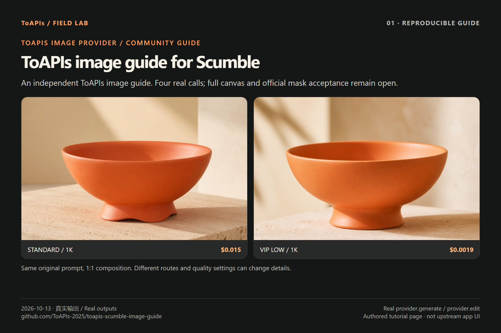

# ToAPIs image-provider guide for Scumble

[简体中文](README_zh-CN.md) · [Original Scumble](https://github.com/DenRakEiw/scumble) · [Image acceptance checklist](ACCEPTANCE.md) · [Prices](PRICING.md) · [Actual charges](COSTS.md)

An independent **ToAPIs-maintained guide** to Scumble's existing image provider, with four real generated/reference-edited images, original inputs and a reusable wrapper. Install Scumble from the upstream project; this repository contains the guide and examples rather than an application release.

Scumble's maintainer acknowledged the four calls in [issue #5](https://github.com/DenRakEiw/scumble/issues/5#issuecomment-6217158456), and recorded the standard/VIP live-run scope in the [recipe](https://github.com/DenRakEiw/scumble/blob/4e6c17e5fc6f2ddbc35d201edaee3a04ac40356d/recipes/gpt_image_2.json) and [provider documentation](https://github.com/DenRakEiw/scumble/blob/4e6c17e5fc6f2ddbc35d201edaee3a04ac40356d/docs/RECIPES.md). This acknowledges the tested API path, not an endorsement, sponsorship or partnership.

**Scumble is an image editor with no video features.** Support for this guide follows the maintainer's image acceptance checklist. The official-channel mask edit remains for upstream to validate; our four calls do not validate it.

## Four real image outputs

Tested October 13, 2026, at upstream SHA `0d0be6b3e41f00e8621af14fe11597eaf258501f`. The wrapper invokes the unchanged `electron/main/providers/toapis.js` module: upload → generate/edit → query the same task → download. All four outputs are 1024×1024 PNGs.



| Example | Exact API ID / preset | Dashboard-confirmed charge | Original output |
|---|---|---:|---|
| Cream studio | `gpt-image-2-vip` / low / 1K | $0.0019 | [PNG](assets/vip-low-coral-bowl.png) |
| Dark studio, reference edit | `gpt-image-2-vip` / low / 1K | $0.0019 | [PNG](assets/vip-low-dark-bowl.png) |
| Sunlit interior, reference edit | `gpt-image-2-vip` / low / 1K | $0.0019 | [PNG](assets/vip-low-interior-bowl.png) |
| Standard studio | `gpt-image-2` / 1K | $0.015 | [PNG](assets/standard-coral-bowl.png) |

Total: **4.14 credits = $0.0207**, confirmed by the account owner's dashboard screenshot; the original API responses had no billing value. An earlier submission with incorrect context returned no task ID; its acceptance/cost remain unknown and are excluded. [Cost provenance](COSTS.md) · [Original prompts](cases/briefs.json) · [Full gallery](GALLERY.md).

The low/1K preset for **gpt-image-2(VIP) is $0.0019/image** in this historical run; other presets start at different prices. Models and quality settings differ. Dated ToAPIs rates and charges are maintained in this guide; upstream provider descriptions remain neutral.

## Run the provider examples

Node 20+ (tested 24.19.0) and Git. Install the Electron application using upstream instructions. The commands below exercise the provider module without launching the canvas. Default mode makes no API request; `--live` explicitly submits paid calls.

```bash
git clone https://github.com/ToAPIs-2025/toapis-scumble-image-guide.git

git clone https://github.com/DenRakEiw/scumble.git scumble-upstream

git -C scumble-upstream checkout 0d0be6b3e41f00e8621af14fe11597eaf258501f

cd toapis-scumble-image-guide

cp .env.example .env

# Fill TOAPIS_API_KEY privately. Windows PowerShell: Copy-Item .env.example .env

node run_cases.cjs --upstream ../scumble-upstream

node ../scumble-upstream/tools/toapis_test.js

node run_cases.cjs --upstream ../scumble-upstream --key-file .env --live --case vip-low-coral-bowl

node run_cases.cjs --upstream ../scumble-upstream --key-file .env --live
```

The dark/interior edits depend on `vip-low-coral-bowl`. Completed evidence is reused. A stored submission without a completed result stops execution: query the original task before considering another submission. Use the system CA/proxy configuration; keep TLS verification enabled.

## Provider mapping and validation boundary

1. Set `ctx.key` and **`ctx.base`** (origin, e.g. `https://toapis.cn`), rather than `ctx.settings`.
2. Standard uses `gpt-image-2` with quality omitted. VIP uses `gpt-image-2-vip`, `quality=low`, `resolution=1k`, `n=1`, `size=1:1`.
3. Reference images: `POST /v1/uploads/images`, then the uploaded URL in `reference_images`.
4. Generation: `POST /v1/images/generations`; status: `GET /v1/images/generations/{id}`; download the result without forwarding the API key.
5. The wrapper adds durable submission records, one generation POST per case, at least 8-second polling intervals, original-byte outputs and SHA-256 evidence.

The two reference edits are whole-image instruction edits. They do not validate alpha-mask inpainting. Canvas interaction, selection stitching, layer export and masked editing remain unvalidated here. The maintainer has recorded the upload/query/size results for standard and VIP; boundary limits and full canvas round trips still need separate acceptance. See [the five-item checklist](ACCEPTANCE.md).

## Upstream credit and support

The Scumble maintainer keeps provider documentation neutral and does not maintain vendor price-comparison pages. We maintain ToAPIs-specific configuration, dated costs and support evidence here. For an image-provider problem, supply the Scumble commit/version, recipe/channel, crop and mask dimensions, expected versus actual pixels, and a redacted error. Exchange private credentials and account details only through a private support channel.

The original author referral URL `https://toapis.com/login?aff=vfR1` is preserved. Its ownership and payout arrangements remain unverified; this guide does not claim or replace that code.

[Scumble source and license](https://github.com/DenRakEiw/scumble/tree/0d0be6b3e41f00e8621af14fe11597eaf258501f) · [GPL-3.0](LICENSE) · [ToAPIs model page](https://go2v.toapis.com/1013_scumble_cheaper_gh_en) · [Reusable guide images](SCREENSHOT_GUIDE.md)
