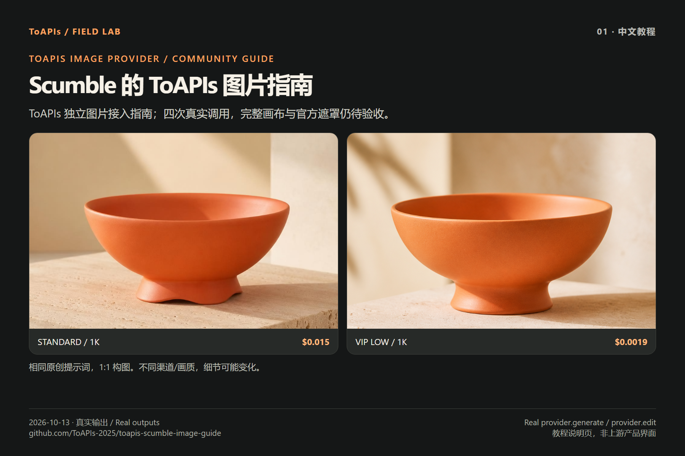

# Scumble 的 ToAPIs 图片接入指南

[English](README.md) · [Scumble 原项目](https://github.com/DenRakEiw/scumble) · [图片验收清单](ACCEPTANCE_zh-CN.md) · [模型价格](PRICING_zh-CN.md) · [实际消费](COSTS_zh-CN.md)

这是由 **ToAPIs 独立维护的图片 Provider 接入指南**，提供四张真实生成/参考改图、原创输入和可复用 wrapper。Scumble 应用请从上游项目安装；本仓库提供教程与示例。

Scumble 作者已在 [原 Issue #5](https://github.com/DenRakEiw/scumble/issues/5#issuecomment-6217158456) 认可四次真实调用，并在 [recipe](https://github.com/DenRakEiw/scumble/blob/4e6c17e5fc6f2ddbc35d201edaee3a04ac40356d/recipes/gpt_image_2.json) 与 [Provider 文档](https://github.com/DenRakEiw/scumble/blob/4e6c17e5fc6f2ddbc35d201edaee3a04ac40356d/docs/RECIPES.md) 中记录标准/VIP 通道的实测范围并注明来源。该记录仅确认调用证据，不代表官方背书、赞助或已建立商务合作。

**Scumble 是图片编辑器，没有视频功能。** 后续支持按作者的图片验收清单推进。官方通道遮罩编辑由作者自行验收，现有四次调用未覆盖该项。

## 四张真实图片与消费

2026-10-13，基于上游固定 SHA `0d0be6b3e41f00e8621af14fe11597eaf258501f`，通过未修改的 `electron/main/providers/toapis.js` 完成上传 → 生成/参考改图 → 查询原任务 → 下载。四张输出均为 1024×1024 PNG。



| 案例 | 精确 API ID / 档位 | 后台确认消费 | 原图 |
|---|---|---:|---|
| 浅色棚拍 | `gpt-image-2-vip` / low / 1K | $0.0019 | [PNG](assets/vip-low-coral-bowl.png) |
| 深色棚拍，参考改图 | `gpt-image-2-vip` / low / 1K | $0.0019 | [PNG](assets/vip-low-dark-bowl.png) |
| 日照室内，参考改图 | `gpt-image-2-vip` / low / 1K | $0.0019 | [PNG](assets/vip-low-interior-bowl.png) |
| 标准棚拍 | `gpt-image-2` / 1K | $0.015 | [PNG](assets/standard-coral-bowl.png) |

合计 **4.14 积分=$0.0207**，来源为账号持有人确认的后台消费截图；原始 API 回执的 billing 为空。另有一次早期错误上下文配置的提交未返回任务 ID，受理与费用未知，未计入合计。[消费依据](COSTS_zh-CN.md) · [原创输入](cases/briefs.json) · [原图画廊](GALLERY.md)。

本历史实测中 **gpt-image-2(VIP) low/1K 为 $0.0019/image**；一般宣传口径为 $0.0019/image 起。不同模型和档位的效果不同。带日期的 ToAPIs 报价和消费由本指南维护，上游 Provider 文档保持中立。

## 运行 Provider 示例

Node 20+（实测 24.19.0）、Git。Electron 产品按上游说明安装；以下命令直接运行 Provider，不启动画布。默认不调用 API，只有 `--live` 显式发起付费请求。

```bash
git clone https://github.com/ToAPIs-2025/toapis-scumble-image-guide.git

git clone https://github.com/DenRakEiw/scumble.git scumble-upstream

git -C scumble-upstream checkout 0d0be6b3e41f00e8621af14fe11597eaf258501f

cd toapis-scumble-image-guide

cp .env.example .env

# Fill TOAPIS_API_KEY privately. Windows PowerShell: Copy-Item .env.example .env

node run_cases.cjs --upstream ../scumble-upstream

node ../scumble-upstream/tools/toapis_test.js

node run_cases.cjs --upstream ../scumble-upstream --key-file .env --live --case vip-low-coral-bowl

node run_cases.cjs --upstream ../scumble-upstream --key-file .env --live
```

深色/室内参考改图依赖 `vip-low-coral-bowl`。已有完成记录直接复用；已有提交记录却没有完成结果时停止，先查询原任务。代理按系统 CA/代理配置，保持 TLS 验证开启。

## 接口映射与验收边界

1. 使用 `ctx.key` 和 **`ctx.base`**（如 `https://toapis.cn`），不是 `ctx.settings`。
2. Standard 使用 `gpt-image-2`、不传 quality；VIP 使用 `gpt-image-2-vip`、`quality=low`、`resolution=1k`、`n=1`、`size=1:1`。
3. 参考图片通过 `POST /v1/uploads/images` 上传，把返回的 URL 放入 `reference_images`。
4. `POST /v1/images/generations` 提交，`GET /v1/images/generations/{id}` 查询同一任务，下载结果时不转发 API Key。
5. Wrapper 保存持久提交记录，每案例提交一次生成 POST，轮询间隔至少 8 秒，保存原始图片字节及 SHA-256。

两次参考改图属于整图指令编辑，不能视为 alpha mask 局部重绘验收。画布交互、选区回填、图层导出和遮罩编辑仍待验证。作者已记录标准/VIP 通道的上传、查询和输出尺寸证据；边界限制与完整画布往返需另行验收，详见[五项清单](ACCEPTANCE_zh-CN.md)。

## 作者归因与技术支持

尊重作者保持上游文档中立、不维护厂商价格比较的要求。ToAPIs 专属配置、带日期的费用和排障材料保留在本指南。图片 Provider 排障需要：Scumble 版本/SHA、recipe/通道、选区及 mask 尺寸、预期与实际输出尺寸、脱敏错误。凭证和账号信息通过私有支持渠道交换。

保留原作者推荐入口 `https://toapis.com/login?aff=vfR1`，归属及分成尚未核实；本指南不替换或宣称拥有该推荐码。

[原项目及固定版本](https://github.com/DenRakEiw/scumble/tree/0d0be6b3e41f00e8621af14fe11597eaf258501f) · [GPL-3.0](LICENSE) · [ToAPIs 模型页](https://go2v.toapis.com/1013_scumble_cheaper_gh_cn) · [可复用教程图](SCREENSHOT_GUIDE_zh-CN.md)
